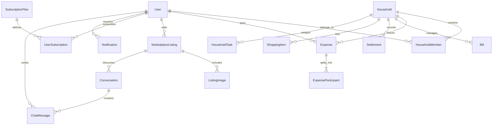

# Vyna Platform Architecture & Database Schema

## 1. System Architecture Overview

Vyna is structured as a monorepo containing three core applications:

1. **`apps/api`**: FastAPI Python backend with SQLAlchemy ORM, Pydantic v2 data contracts, and JWT authentication.
2. **`apps/web`**: Next.js 14 App Router frontend with Tailwind CSS, TypeScript, Framer Motion, and Lucide icons.
3. **`apps/mobile`**: React Native / Expo application with cross-platform screens for iOS & Android.
4. **`packages/shared-types`**: Shared TypeScript contracts ensuring parity across web and mobile applications.

---

## 2. Mandatory Design System & Color Palette

- **Primary Navy**: `#14213D` (Sidebar, Navbar, Primary cards)
- **Cream**: `#F4EDE0` (Primary application background)
- **Coral**: `#FF6B5B` (Primary action buttons, active badges, highlights)
- **White**: `#FFFFFF` (Card surfaces, clean modals)
- **Muted Blue**: `#A9B4C3` (Secondary captions, muted borders)
- **Secondary Navy**: `#253A56` (Sub-headers, elevated surfaces)

---

## 3. Entity-Relationship (ER) Schema

### Key Database Tables:
1. `users`: Stores profiles, hashed passwords, roles (`user`, `household_owner`, `household_admin`, `platform_admin`, `super_admin`), and subscription tiers (`free`, `basic_plus`, `premium`).
2. `households`: Multi-tenant data boundary. Generates unique uppercase invitation codes (`invitation_code`).
3. `household_members`: Tenant-aware member roster with role isolation.
4. `expenses`: Shared expenses stored in integer **paise** (`total_amount_paise`) to eliminate floating-point roundoff errors.
5. `expense_participants`: Individual shares in paise, percentage breakdown, and payment status.
6. `bills`: Recurring and upcoming utility bills (electricity, water, internet, rent, maintenance, gas) with recurrence rules.
7. `settlements`: Payer to Payee payment log with UPI references, proof attachments, and two-party confirmation flow.
8. `shopping_items`: Collaborative flat supplies checklist with real-time status and assignees.
9. `household_tasks`: Chore rotation with due dates and recurrence.
10. `marketplace_listings`: Pre-owned goods with multi-image support, condition indicators, location, and Moving Out collections.
11. `conversations` & `chat_messages`: In-app buyer-seller chat with product context.
12. `subscription_plans`: Configurable annual pricing tiers (Free ₹0, Basic Plus ₹49, Premium ₹99).
13. `payment_transactions`: Server-side verified Razorpay orders, signatures, and idempotency ledger.
14. `admin_audit_logs`: Traceability log for administrative moderation and security actions.

---

## 4. Financial Calculation Precision & Security Model

- **Paise Precision**: All monetary values are handled as integer paise (1 Rupee = 100 Paise). Floating-point calculation is strictly avoided in database columns and backend validations.
- **Tenant-Aware Isolation**: Regular household users cannot read or modify another flat's records. Database queries enforce `household_id` filtering via dependency injection.
- **Server-Side Verification**: Client reports of successful payments are never trusted. The backend verifies Razorpay HMAC-SHA256 signatures before activating subscriptions.
